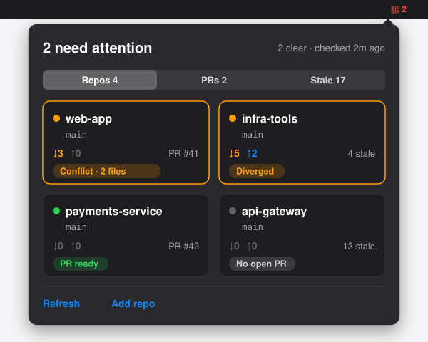

# base-branch-watch

A macOS menu-bar companion that keeps you honest about two things you'll otherwise forget:

1. **"Did the base branch move since I last synced?"** - no more manually `git fetch`-ing every repo to check.
2. **"Will my push actually conflict with something?"** - no more finding out *after* you've already pushed.

It watches your repos in the background, shows live status in the menu bar, warns you before a real merge conflict happens, and - once your PR is open - shows you its checks/review/mergeable state without leaving the menu.



## What it does

- **Watches any number of repos**, each with one or more base branches (e.g. `main`, or a team integration branch like `perps-funding-rate-dev`)
- **Menu bar shows live status per repo**: up to date / behind / unpushed / diverged / ⚠️ conflict risk
- **Multi-base repos** expand into a real submenu, one row per base branch
- **Conflict-risk warning**: if merging the base branch's incoming changes into yours would really conflict (checked with a safe `git merge-tree` dry run), or the incoming changes touch a file you have uncommitted edits to, the badge escalates to "⚠️ conflict risk" instead of a plain "behind" count - you see this *before* you ever try to push
- **Pre-push gate**: every `git push` in a watched repo is preceded by a summary of what's new on the base branch. If a real conflict is detected (via a safe dry-run, nothing is touched), you get an interactive "Push anyway?" prompt - default is to stop, but it's your call
- **PR status in the menu**: once you've opened a PR, see its checks/review/mergeable state as a second row per repo, sourced via the `gh` CLI (reuses your existing `gh auth login` - no new login, no new token)
- **Stale branch hints**: local branches whose branch on `origin` was deleted (the usual end of a merged PR), or that are already merged into your base branch, show up as one "🧹 N stale branches" row per repo, so you know what is safe to clean up. Informational only: it never changes the menu-bar icon, never notifies and never deletes anything
- **One consolidated notification** per polling cycle (not spammy per-repo popups), deduped so you're not renotified for the same change
- **Parallel, bounded-concurrency fetches** - adding more repos doesn't slow down each cycle
- **Runs as a `launchd` LaunchAgent** - starts at login, survives crashes

## How it works, in plain English

Think of it as a small robot that, every few minutes, quietly runs `git fetch` on every repo you've told it about, then asks two questions:

1. *"Is my current branch behind the base branch?"* - if yes, how far, and does the incoming stuff touch any file I've also touched? (That second check is the conflict-risk warning - it's the difference between "you're behind" and "you're behind **and it matters**.")
2. *"Have I pushed everything I've committed locally?"* - if not, that's the "unpushed" state.

None of this touches your working directory or commits anything on your behalf. It only *reads* - `git fetch`, `git log`, `git diff`, `git merge-tree` (a **dry-run** merge that computes whether two branches would conflict, without actually merging or touching a single file). The only place it ever *gates* an action is at `git push` time, via a small hook it installs for you, and even there it just prompts - you always have the final word.

## Why not just use my IDE's built-in "ahead/behind" indicator?

IntelliJ, VS Code, and friends all show a small ahead/behind count for your current branch - so why build this instead of just glancing at that?

| | Your IDE's indicator | base-branch-watch |
|---|---|---|
| **Scope** | Only the one project open in that editor window, right now | Every repo you've configured, all the time - you don't need the IDE open, or even running |
| **What it tells you** | A count: "3 behind" | A count *plus a verdict*: "3 behind, and one of those commits touches a file you've edited" (via a real `git merge-tree` dry-run merge, not a guess) |
| **When it acts** | Passive - you have to look at it | Ambient in the menu bar *and* it actively gates the one moment that matters: `git push` itself, via a pre-push hook |
| **Refresh** | Usually needs the editor's own fetch (auto or manual), tied to that session | Independent background polling on its own timer, with parallel fetches across all watched repos |
| **PR awareness** | Separate plugin/panel, if it exists at all | Built in, in the same menu, reusing your existing `gh` login |

The short version: an IDE's indicator tells you a *fact* ("you're behind"). This tool tells you a *verdict* ("this will actually conflict, or it won't") and enforces the check at the one moment it matters - right before you push - regardless of which project you happen to have open.

## Install

```bash
git clone https://github.com/armaanpant-integral/base-branch-watch.git
cd base-branch-watch
python3 -m venv .venv
source .venv/bin/activate
pip install -e ".[dev]"
```

Then install it as a LaunchAgent so it runs continuously and survives login/logout:

```bash
python -m base_branch_watch.cli install-agent "$(pwd)/.venv/bin/python3"
```

> **Don't omit the interpreter path above.** The installer's auto-detect can pick your system Python instead of this venv, producing a LaunchAgent that silently fails at every login. Always pass your venv's interpreter path explicitly, as shown.

Full setup details, macOS Full Disk Access / notification-permission gotchas, uninstall and update steps: see [INSTALL.md](INSTALL.md). The app checks for new versions of itself daily and shows "Update available" in the menu.

## Using it

Click the menu bar icon to see watched repos and their status.

**Per-repo rows:**

| You see | It means |
|---|---|
| ✅ up to date | Your branch and the base branch match - nothing to do |
| 🟡 N behind | The base branch moved ahead by N commits - safe to pull, no overlap with your changes |
| 🟠 N unpushed | You've committed locally but haven't pushed yet |
| 🔴 diverged | You're both behind *and* ahead - a real merge/rebase is needed |
| ⚠️ conflict risk | Merging the base branch would conflict (or its incoming changes touch a file you have uncommitted edits to) - pulling *will* need manual conflict resolution |

> **What counts as a conflict risk?** Committed work is judged by `git merge-tree`, the same dry run the pre-push gate uses, so the menu and the gate agree: two branches editing the same file in different places merge cleanly and do not flag. Uncommitted edits (staged, unstaged, untracked) cannot be merge-tested, so for those the rule is simpler: an incoming change to a file you have uncommitted edits to flags. If `git merge-tree` cannot run, it falls back to "incoming and local changes touch the same file". Everything is recomputed fresh from live git state on *every* poll cycle - nothing is cached or persisted between checks - so a warning can appear or disappear from one refresh to the next as the base branch moves or your branch catches up. That's expected behavior, not a bug.
| 🔀 PR #N - ✅/❌/⏳ ... | Your current branch's open PR: checks · review · mergeable state (click to expand) |
| ⚪ no open PR | Current branch has no PR yet |
| ✅ PR #N merged / ⚫ closed | One-cycle confirmation that your PR landed (or was closed without merging) |
| ⚠️ PR status - ... | `gh` isn't installed / isn't logged in / is rate-limited - this never blocks the git-status row above it |
| 🧹 N stale branches | Local branches you can likely delete (click to expand). Each is labelled: *remote deleted, merged* (safe), *remote deleted, NOT merged (check before deleting)* (a squash merge or lost work, so look first), or *merged, remote branch still exists*. Never lists the checked-out branch, a watched base branch, a branch with no upstream, or one tracking a remote other than `origin`. If `origin` can't be read that cycle the row simply disappears (the app log notes it) rather than guessing |

**Menu actions:**

- **Add Repo…** - pick a repo folder; base branch is auto-detected from `origin`'s default, editable
- **Edit Base Branch(es)** - change a repo's watched base branch(es) without removing and re-adding it
- **Remove Repo**
- **Set Interval…** - change the polling interval (default 300s; PR-status checks are separately floored to no faster than every ~2 minutes, since CI/review state doesn't change second-to-second)
- **Refresh Now**
- **Open Log** - opens the app's own event log (see below) in TextEdit

There are two separate log files, and they're not the same thing:

- **App event log** - `~/Library/Application Support/base-branch-watch/base-branch-watch.log`. Truncated and rotated at each day boundary (not appended-forever), tracked via a sibling `.base-branch-watch.logday` marker file. One line per check-cycle event: cycle-start timestamps, per-repo `[OK]`/`[FAIL]` status lines (repo basename, behind/ahead counts, base branch name), and pre-push hook install/uninstall results. When a `git fetch` fails, an extra `[FAIL] fetch failed for <repo path> (base <branch>, cause <label>): ...` line records the classified cause plus git's full stderr (collapsed to one line, capped at 1000 chars) - this is where to look when the menu only shows a short `fetch failed (<cause>): ...` excerpt. Otherwise lines use the repo's basename, and no secrets or tokens are logged by the app itself (git's own stderr is logged as-is, so it can include the remote URL and the repo's full path). This is what "Open Log" opens.
- **launchd stdout/stderr redirects** - `~/Library/Application Support/base-branch-watch/launchd.stdout.log` and `launchd.stderr.log`. Raw stdout/stderr from the Python process itself, set via `StandardOutPath`/`StandardErrorPath` in the LaunchAgent plist. Not surfaced in the menu - check these manually if the app crashes or fails to start, not for day-to-day status.

**When you `git push`:** you'll always see a short summary of what's new on the base branch. If - and only if - a real conflict would result, you're asked "Push anyway? [y/N]"; answer `n` to abort and pull/rebase first. With no terminal available (pushes run by an IDE or agent) the warning is printed and the push is allowed. Set `BBWATCH_SKIP_GATE=1` to bypass the check entirely for one push.

## Known Issues

- **Pre-push hook silently fails (forcing `--no-verify`) if `.venv`'s files carry macOS's hidden flag - fixed on 2026-08-30, watch for recurrence.** Python 3.12+'s `site.py` silently skips loading any `.pth` file that has the filesystem-level "hidden" attribute (`UF_HIDDEN`, distinct from a dotfile name) - this is a CPython security hardening, not a bug in this project. If something (a sync tool, an install script, `chflags`) ever marks `.venv/lib/**` as hidden, the editable install's `.pth` file stops being read, `python3 -m base_branch_watch.hook` starts raising `ModuleNotFoundError: No module named 'base_branch_watch'` for every watched repo *except* base-branch-watch's own (which accidentally still works because of `cwd`-based import fallback), and every `git push` in those repos gets hard-blocked regardless of actual conflict status. Symptom: you find yourself needing `git push --no-verify` "sometimes" for no obvious reason. Check with `ls -lO .venv/lib/python3.12/site-packages/` (a `hidden` column means this is happening) and fix with `chflags -R nohidden .venv`; confirm the fix by running `cd /tmp && <path to venv>/bin/python3 -c "import base_branch_watch"` from that unrelated cwd and checking it no longer raises `ModuleNotFoundError`. Do not reach for `--no-verify` as a standing workaround - it skips the conflict-risk gate entirely, which defeats the point of this tool; run the `chflags` fix instead and confirm with the `/tmp`-cwd import check above.

- **PR status can say "gh not installed" even when it is.** The LaunchAgent inherits launchd's bare default PATH (`/usr/bin:/bin:/usr/sbin:/sbin`), which doesn't include Homebrew's `/opt/homebrew/bin` (Apple Silicon) or `/usr/local/bin` (Intel) where `gh` typically lives. `core/pr_status.py` resolves `gh`'s location once via `shutil.which("gh")` at import time with no fallback path. Fixed: the installer now bakes its PATH into the LaunchAgent plist, so re-run `install-agent` to pick the fix up if your agent was installed before it. Terminal-run `bbwatch` commands are unaffected - only the menu-bar app's background PR-status checks are.

## Development

```bash
source .venv/bin/activate
pytest tests/ -q
ruff check .
```

Built test-first (TDD) with a UI-free `core/` library - see [CLAUDE.md](CLAUDE.md) for the full architecture/stack rationale.

## Status

**v1.0 MVP - shipped 2026-07-15.** All four phases (status monitor, conflict-risk heuristic, pre-push gate, PR status) are built, tested, and in daily use. See `.planning/milestones/v1.0-ROADMAP.md` for the full phase-by-phase history, or `.planning/PROJECT.md` for what's being considered for v1.1.

## License

Personal project, no license file yet - ask before reusing outside personal/internal use.
</content>
